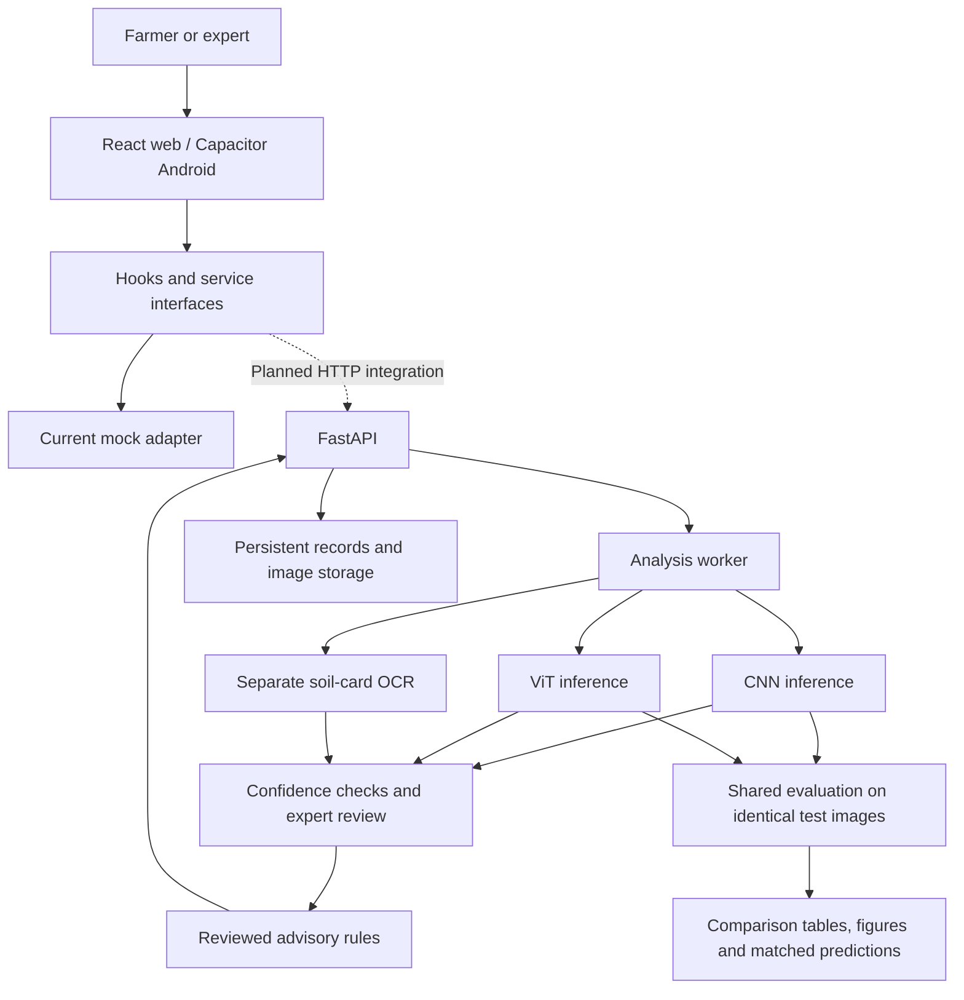

# CropWise — Project Synopsis

**Title:** CropWise: Pesticide Usage Advisory and Organic Farming Awareness System with Comparative CNN and Vision Transformer Models for Crop Disease Classification

**Context:** VTU community/societal project, RV Institute of Technology and Management.

## Abstract

CropWise proposes a multilingual web and Android application that helps farmers understand possible crop diseases, interpret Soil Health Cards, compare chemical and organic management options, and track treatments and harvest waiting periods. The machine learning component will develop **both a convolutional neural network (CNN) and a Vision Transformer (ViT)** for leaf image classification. Both models will be evaluated on the same held-out images. Their classification quality, computational requirements and failure cases will be documented for college project review. Neither model is assumed to perform better in advance. Soil-card OCR and the advisory rules engine remain separate components.

## Problem statement

Farmers may struggle to distinguish visually similar crop symptoms, interpret soil reports, calculate field-specific treatment quantities and maintain treatment records. Language and connectivity constraints can also limit access to information. CropWise brings these workflows together while comparing CNN and ViT approaches on the selected disease dataset and deployment constraints.

## Objectives

1. Develop and fine-tune both a CNN and a ViT with a common healthy/disease label set.
2. Compare both using identical dataset splits and reproducible evaluation procedures.
3. Present aggregate and per-class results, confusion matrices, matched image predictions, latency and model size for college review.
4. Integrate a validated inference path with the planned backend, recording model provenance.
5. Extract Soil Health Card readings through separate OCR and user confirmation.
6. Provide reviewed chemical and organic options, field-area calculations and treatment tracking.
7. Support farmer/expert roles, local languages, cached reads and offline submission.

## Methodology

Collect and verify labeled leaf images, document sources and permissions, and define supported crops/classes. Remove duplicates and keep related images from the same plant or capture session together before producing shared train/validation/test manifests. Fine-tune pretrained CNN and ViT models, initially considering EfficientNet-B0 and ViT-B/16. Final variants depend on available hardware and dataset suitability.

Use validation data for tuning and checkpoint selection. Keep test data untouched until final evaluation. Compare accuracy, macro precision/recall/F1, per-class scores, confusion matrices, inference latency, checkpoint size and training time. Where available, reserve a separate field-photo test set and report it separately. Record preprocessing, random seeds, pretrained weights, split versions, tuning budgets and hardware. Export both models' predictions against the same image IDs to show agreements and disagreements.

Evaluate confidence calibration and non-leaf/unknown-input rejection separately. The frontend's mock 0.70 confidence threshold is provisional. Disease classification alone does not measure severity, affected leaf area or treatment dosage; these require separately validated methods or reviewed rules.

## Architecture

Both models are research deliverables. The eventual app may use a selected model, while retaining both models' review results. Displaying both predictions in the app requires additional API/schema/UI work. Combining predictions into an ensemble is outside the initial scope.

## Modules and technology

| Module | Technology / responsibility |
| --- | --- |
| Web | React, Vite, Tailwind and React Router |
| Android | Shared frontend packaged with Capacitor |
| State and data boundary | Zustand, TypeScript, Zod and service adapters |
| Disease classification | Planned Python/PyTorch pipelines for pretrained CNN and ViT fine-tuning |
| Evaluation | Shared metrics, CSV exports, comparison figures and matched examples |
| Soil interpretation | Separate OCR, extracted-value confirmation and history |
| Backend | Planned FastAPI with background analysis workers |
| Storage | Database and image storage to be selected |
| Advisory and tracking | Reviewed protocols, field quantities, treatment records and reminders |
| Accessibility | Localization, read-aloud, large controls, offline cache and outbox |

## Expected outcomes and college review evidence

Deliver two trained classifiers and a reproducible comparison: dataset/class counts, split documentation, architecture diagrams, training curves, per-class metrics, confusion matrices, matched predictions and timing measurements. Discuss quality versus computational cost and make an evidence-based deployment recommendation. Present both results regardless of which model performs better.

All scores must come from actual experiments. No accuracy target is represented as an achieved result, and generalization claims must be limited to tested data.

## Current status and limitations

The repository currently contains a frontend prototype with mock analysis/advisory data, Android scaffolding and service contracts. The ML folder includes an executable source-download and data-preparation pipeline, explicit label mappings, shared versioned split manifests, an experiment specification and empty model-result templates. From a fresh clone, `python ml/run_cnn.py` creates the training environment, downloads and verifies the pinned sources, builds the prepared release, and launches EfficientNet-B0 fine-tuning. No model has been trained yet. ViT training, inference endpoints, backend persistence and soil OCR remain to be implemented.

Leaf classification covers only the selected classes and cannot diagnose every disease or nutrient issue. Field evaluation and expert-reviewed protocols are required before practical use. Demo results are not validated agricultural advice.
